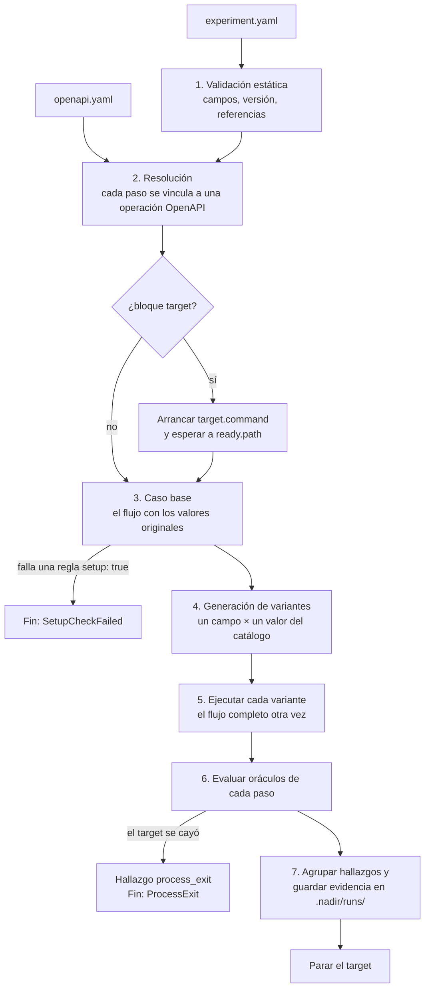

# Nadir

Nadir busca errores en APIs HTTP locales. Ejecuta un **flujo de trabajo** de varias peticiones (por ejemplo: iniciar sesión → obtener una plantilla → crear un registro → verificarlo), luego repite ese flujo cambiando **un solo campo a la vez** con valores problemáticos, y comprueba en cada repetición unas **reglas** (oráculos) que tú defines. Cada regla que falla queda guardada como evidencia JSON que se puede **reproducir** después para confirmar si el error se corrigió.

Tú describes el flujo en un archivo YAML (el *experimento*), y las operaciones HTTP se toman de la especificación OpenAPI de tu servicio.

> **Estado actual:** Nadir prueba valores de catálogos fijos, valores derivados del esquema OpenAPI de cada campo (`mode: schema`) y tus propios valores. Con `strategy: fuzz` añade una fase de **casos aleatorios** reproducibles por semilla. Es fuzzing de caja negra: el fuzzing guiado por cobertura (`target.coverage`, `--corpus`) se reconoce en el YAML, pero `nadir run` lo rechaza. Más detalles en [Limitaciones](#limitaciones).

---

## Índice

1. [Cómo funciona](#cómo-funciona)
2. [Inicio rápido (demo)](#inicio-rápido-demo)
3. [Comandos y códigos de salida](#comandos-y-códigos-de-salida)
4. [Configuración: el archivo de experimento](#configuración-el-archivo-de-experimento)
5. [Resultados y reproducción](#resultados-y-reproducción)
6. [Guía: probar tu propio servicio](#guía-probar-tu-propio-servicio)
7. [Limitaciones](#limitaciones)
8. [Arquitectura del código](#arquitectura-del-código)

---

## Cómo funciona



Paso a paso:

1. **Validación estática.** Se lee el YAML. Cualquier campo desconocido o mal escrito es un error. Se comprueba la versión (`1`), que los `id` de paso no se repitan, que un paso solo haga referencia a pasos *anteriores*, y que no mutes un campo que ya fijaste con `bind`.
2. **Resolución contra OpenAPI.** Cada paso indica un `operation_id`. Nadir lo busca en el OpenAPI para saber el método, la ruta, los parámetros de ruta obligatorios, si la operación admite `bearerAuth` y el cuerpo JSON de ejemplo.

   Si el experimento tiene un bloque [`target`](#target-que-nadir-arranque-tu-servicio), Nadir arranca ahora tu servicio y espera a que responda. Si no lo tiene, el servicio debe estar ya corriendo.
3. **Caso base (baseline).** Se ejecutan todos los pasos en orden con los valores normales. Para cada petición:
   - el cuerpo parte del `example` del `requestBody` en el OpenAPI, y luego se aplican los valores de `bind`;
   - se resuelven las referencias `${...}`: variables de entorno, salidas de pasos anteriores (como un token) y un `${case.id}` único por caso;
   - después de recibir la respuesta se extraen los `outputs` y se evalúan los `oracles`.

   Si una regla marcada con `setup: true` no pasa en el caso base, la ejecución se detiene, porque las variantes no tendrían sentido (por ejemplo, si el login falla).
4. **Generación de variantes.** Para cada campo declarado en `cases.mutators`, Nadir genera un caso por cada valor del catálogo. Se omiten los duplicados y los valores iguales al del caso base. Cada variante cambia **exactamente un campo de un paso**.
5. **Ejecución de variantes.** Cada variante vuelve a ejecutar el flujo **completo** desde el principio, con un `${case.id}` nuevo. Los valores dinámicos, como los tokens, se obtienen otra vez en cada caso. Después se ejecutan los `cases.examples`, si los hay. Si Nadir arrancó el servicio y este muere durante un caso, se registra un hallazgo `process_exit` y la ejecución se detiene. Con `strategy: fuzz`, después sigue una [fase de casos aleatorios](#exploration-enumeración-o-fuzzing) hasta agotar `duration_s` o `max_execs`.
6. **Evaluación.** Cada oráculo da un veredicto: `pass`, `fail`, `skipped` (no se cumplió su condición `when`) o `inconclusive` (no hubo respuesta utilizable, por ejemplo por un timeout).
7. **Hallazgos y evidencia.** Cada `fail` es un hallazgo. Los hallazgos repetidos se agrupan por paso, regla y categoría. Se escriben `run.json` y un JSON por caso, con un *plan de regresión* que permite reproducir la variante exacta más tarde.

### Medidas de seguridad integradas

- Solo se hacen peticiones a direcciones **loopback**: `127.0.0.0/8` o `[::1]`. El nombre `localhost` se rechaza; usa la IP.
- No se siguen redirecciones (se devuelve el 3xx tal cual) y no se usa ningún proxy.
- Los cuerpos de respuesta se truncan a 256 KiB. Un cuerpo truncado produce `inconclusive` en el oráculo `openapi`.
- Los valores de las variables de entorno y los `outputs` con `secret: true` se ocultan en los reportes y en la evidencia.

---

## Inicio rápido (demo)

Requisitos: Linux, Rust estable con Cargo, Python 3.9 o superior y los puertos locales 8080, 8081 y 8091 libres. Ejecuta los comandos desde la raíz del repositorio. No hace falta definir ninguna variable de entorno.

```bash
cargo build
```
```bash
./target/debug/nadir run examples/create-record/experiment.yaml
```

El bloque [`target`](#target-que-nadir-arranque-tu-servicio) del experimento hace que Nadir arranque la API de ejemplo ([tests/fixtures/python_api/server.py](tests/fixtures/python_api/server.py)), espere a que responda en `/health`, ejecute [el experimento create-record](examples/create-record/experiment.yaml) y pare la API al terminar. Salida esperada:

```text
Target ready: pid 12844 at http://127.0.0.1:8080/health
Enumeration cases: 7
Findings: 0
Stop reason: EnumerationComplete
Run record: …/examples/create-record/.nadir/runs/<run-id>/run.json
```

`Enumeration cases: 7` cuenta las variantes, sin incluir el caso base: 2 valores de cabecera (`en`, `es`) más 5 valores *edge cases* para `title`.

Ahora activa un error a propósito en el servidor (la plantilla devuelve un título distinto cuando `Accept-Language: es`):

```bash
NADIR_FIXTURE_MODE=title_regression ./target/debug/nadir run examples/create-record/experiment.yaml
```

```text
step get_template, rule template-title-preserved: fail; expected "Invoice Template", observed "Invoice Template (draft)"
case record: …/.nadir/runs/<run-id>/cases/0002.json
replay: nadir replay '…/experiment.yaml' --case '…/cases/0002.json'
Findings: 1
```

El código de salida es `1`. Reproduce ese caso concreto con y sin el error:

```bash
case_file='/ruta/de/la/linea/case-record.json'
NADIR_FIXTURE_MODE=title_regression ./target/debug/nadir replay examples/create-record/experiment.yaml --case "$case_file"   # sale con 1: el error sigue
./target/debug/nadir replay examples/create-record/experiment.yaml --case "$case_file"                                       # sale con 0: corregido
```

[`demo.py`](examples/create-record/demo.py) hace lo mismo con opciones más cortas: `python3 examples/create-record/demo.py [--regression] [--case archivo.json]`.

---

## Comandos y códigos de salida

Compila con `cargo build` y usa `target/debug/nadir`, o sustituye `nadir` por `cargo run --` desde la raíz.

| Comando | Qué hace |
|---|---|
| `nadir validate experiment.yaml` | Valida el YAML y lo resuelve contra el OpenAPI. No hace peticiones de red. |
| `nadir run experiment.yaml` | Ejecuta el caso base y todas las variantes. Usa un servicio que ya esté corriendo o, si hay bloque `target`, lo arranca y lo para Nadir. |
| `nadir replay experiment.yaml --case case.json` | Repite un caso guardado contra el servicio actual, con un `case.id` nuevo. Con bloque `target`, arranca un servicio nuevo para la repetición. |

Si tu experimento usa una variable de entorno sin valor por defecto (`${env.NOMBRE}`), defínela antes de ejecutar (`export NOMBRE=...`). Si falta, la preparación falla con código `2` y el mensaje indica cuál es. Con `${env.NOMBRE:-valor}`, la variable es opcional.

| Código | Significado |
|---|---|
| `0` | Terminó sin reglas fallidas, o la validación fue correcta. |
| `1` | Hay al menos un hallazgo: una regla falló o el servicio arrancado por Nadir se cayó. |
| `2` | Error de configuración o de infraestructura (por ejemplo, el `target` no arrancó), ejecución incompleta (timeout, conexión cortada, caso base incompleto) o fallo de una regla `setup`. |

Esto permite usar Nadir directamente en CI: `nadir run ... || exit 1`.

---

## Configuración: el archivo de experimento

### Estructura completa

```yaml
version: 1                       # obligatorio, solo existe la versión 1

experiment:
  name: mi-experimento           # nombre libre
  max_cases: 12                  # casos totales, incluido el caso base (1–1000)
  exploration:
    strategy: enumerate          # opcional; "enumerate" (por defecto) o "fuzz", ver más abajo

  target:                        # opcional: Nadir arranca y para tu servicio
    command: ["./mi-servidor", "--port", "${target.port}"]
    ready:
      path: /health

  adapters:
    http:
      base_url: http://127.0.0.1:8080   # solo IPs loopback
      openapi: ./openapi.yaml           # ruta relativa al YAML del experimento
      timeout_ms: 2000                  # opcional, por defecto 2000

  steps:
    - id: login                  # identificador único del paso
      adapter: http              # siempre "http"
      operation_id: login        # operationId en el OpenAPI
      bind: { ... }              # valores de entrada fijos
      auth: { ... }              # token bearer
      outputs: { ... }           # valores para pasos posteriores
      cases: { ... }             # qué variar en este paso
      oracles: [ ... ]           # qué comprobar en este paso
```

### `exploration`: enumeración o fuzzing

```yaml
exploration:
  strategy: fuzz      # "enumerate" (por defecto) | "fuzz"
  duration_s: 60      # obligatorio con fuzz: duración máxima de toda la ejecución, en segundos
  max_execs: 10000    # opcional (por defecto 10000): número máximo de casos aleatorios
  seed: 1             # opcional: semilla (distinta de 0); sin ella se elige una y se muestra
```

- **`enumerate`**: ejecuta el caso base, cada variante de los catálogos y los `cases.examples`, y termina.
- **`fuzz`**: hace lo mismo y después sigue con una **fase aleatoria** hasta que se agota `duration_s` (`Stop reason: DeadlineExpired`) o `max_execs` (`MaxExecsReached`). No hace falta el bloque `target`, pero con él Nadir también detecta si el servicio se cae.

**Cómo es un caso aleatorio.** Cada caso cambia de 1 a 3 campos declarados en los mutadores de **un mismo paso**. Cada valor sale de una de estas fuentes:
- un valor del catálogo del campo (incluidos los de `mode: schema` y tus `values`);
- una mutación de texto del valor base o de un valor del catálogo: insertar tokens peligrosos (`'`, `%s`, `{{7*7}}`, `../../`, `\0`, `\u202e`, números límite…), borrar o duplicar trozos, repetir el texto (hasta 100 000 caracteres), truncarlo o cambiar caracteres;
- un valor JSON extremo de cualquier tipo: enteros límite (`i64::MAX`, 2⁵³+1…), `1e308`, `5e-324`, cadenas largas, listas u objetos anidados.

En las cabeceras solo se envía ASCII visible, para que la petición se pueda construir.

**Reproducible.** Cada caso aleatorio depende solo de la semilla y de su número de iteración. Con la misma `seed` y el mismo experimento se repite la misma campaña (salvo dónde corte el tiempo). Un caso guardado lleva `"fuzz": {"seed": 7, "iteration": 67}`, y `nadir replay` lo regenera a partir de esos dos números.

**Qué se guarda.** Solo los casos aleatorios que fallan alguna regla o tumban el servicio: como máximo 5 por regla y 200 por ejecución, para no llenar el disco. Los casos aleatorios sin respuesta utilizable (timeouts, conexiones cortadas) que no fallan ninguna regla solo se cuentan. `run.json` incluye un resumen en `"fuzz"` (`seed`, `executed`, `kept`, `incomplete`), y la salida muestra:

```text
Enumeration cases: 7
Random cases: 386 (kept 5, seed 7)
Findings: 1
Stop reason: DeadlineExpired
```

Los casos aleatorios no llevan la regla implícita `schema:rejects-invalid`, porque Nadir no sabe si el valor mutado es válido. Encuentran errores a través de tus reglas, de `openapi` (5xx, status no documentados) y de las caídas del `target`.

### `max_cases`: el presupuesto

`max_cases` es el número máximo de ejecuciones del flujo, **contando el caso base**. Con `max_cases: 12` caben 1 caso base y 11 variantes o ejemplos. Con `strategy: fuzz`, `max_cases` solo limita la enumeración; la fase aleatoria tiene su propio presupuesto (`duration_s` y `max_execs`). Si se generan más variantes que espacios disponibles, las que sobran no se ejecutan y el motivo de parada es `MaxCasesReached`. Este motivo no cuenta como error, así que revisa la salida si esperabas cubrirlas todas. El máximo permitido es 1000. Los casos se guardan como `cases/0000.json` … `cases/0999.json`.

### Referencias `${...}`

Se pueden usar en `bind`, `auth.bearer` y, en el caso de `${case.id}`, en `expect.equals`. En el bloque `target` solo se permiten `${env.…}` y `${target.port}`.

| Referencia | Valor |
|---|---|
| `${env.NOMBRE}` | Variable de entorno `NOMBRE`; si no está definida, la ejecución falla. Úsala para contraseñas reales y no las escribas en el YAML. |
| `${env.NOMBRE:-valor}` | Igual, pero usa `valor` si la variable no está definida o está vacía, como en bash. Útil para credenciales de prueba y para opciones como el modo del servidor. El valor no puede contener `}`. Si se usa en `bind`, se oculta en los reportes igual que una variable de entorno. |
| `${case.id}` | UUID único de cada caso. Sirve para crear recursos que no choquen entre casos. |
| `${steps.<id>.outputs.<nombre>}` | Salida extraída de un paso **anterior**. |
| `${target.port}` | Puerto tomado de `base_url`. También se puede usar en `target.command` y `target.env`. |

Puedes combinar texto y referencias: `"${case.id}-user"`.

### `target`: que Nadir arranque tu servicio

Este bloque es opcional. Si lo defines, `nadir run` y `nadir replay` arrancan tu servicio antes del caso base, esperan a que esté listo y lo paran al terminar, también cuando hay un error.

```yaml
target:
  command: ["python3", "-I", "../../tests/fixtures/python_api/server.py",
            "--port", "${target.port}", "--mode", "corrected"]
  ready:
    path: /health          # por defecto "/"
    timeout_ms: 10000      # por defecto 10000
  cwd: .                   # opcional; por defecto, la carpeta del YAML
  env:                     # opcional; se suman al entorno de Nadir
    LOG_LEVEL: debug
```

| Campo | Qué hace |
|---|---|
| `command` | Programa y argumentos. No pasa por una shell. `${target.port}` se sustituye por el puerto de `base_url`, y `${env.NOMBRE}` o `${env.NOMBRE:-valor}` por la variable de entorno. |
| `ready.path` | Nadir hace `GET` a esta ruta en la dirección de `base_url` hasta recibir un status 2xx. |
| `ready.timeout_ms` | Tiempo máximo de espera. Si se agota, Nadir para el proceso y sale con código `2`. |
| `cwd` | Directorio de trabajo, relativo al YAML, igual que `openapi`. Las rutas relativas de `command` (las que contienen `/`) también se resuelven desde ahí, así que el experimento funciona sin importar desde dónde ejecutes `nadir`. |
| `env` | Variables extra para el proceso. El proceso también hereda todas las variables de Nadir, como las contraseñas `${env.…}`. |

Cómo se comporta:

- **Puerto ocupado.** Si ya hay algo escuchando en la dirección de `base_url`, Nadir se niega a arrancar y sale con `2`. Así nunca prueba por error un servicio viejo.
- **El servicio no arranca.** Si el proceso termina o no responde a tiempo, el error incluye las últimas 20 líneas de su stderr. No se crea carpeta de resultados.
- **El servicio se cae durante un caso.** Se registra un hallazgo `process_exit` con el código de salida o la señal y el paso en el que ocurrió, la ejecución se detiene (`Stop reason: ProcessExit`) y se muestran las últimas líneas de su stderr. El caso se puede repetir con `nadir replay`, que arranca un servicio nuevo y sale con `1` si se vuelve a caer.
- **Al terminar.** Nadir envía SIGTERM y, si el proceso sigue vivo a los 2 segundos, SIGKILL.
- **Secretos.** En los extractos de stderr se ocultan las líneas que contienen valores de variables de entorno o de `target.env`.
- **Salida estándar.** stdout del proceso se descarta; solo se captura stderr (los últimos 64 KiB).

Para que la parada funcione, `command` debe arrancar directamente el proceso que escucha en el puerto. Si necesitas una shell, usa `exec`: `["sh", "-c", "exec ./servidor --port ${target.port}"]`. Si un lanzador como `npm` crea procesos hijos, puede que estos no reciban la señal.

> El bloque `coverage` dentro de `target` sigue sin estar disponible: si lo incluyes, `run` lo rechaza antes de arrancar nada.

### `bind`: entradas fijas

```yaml
bind:
  body.user: "admin"                                  # campo del cuerpo JSON
  body.metadata.source: nadir                         # campos anidados con puntos
  body.template_id: "${steps.get_template.outputs.template_id}"
  path.reference: "${case.id}"                        # parámetro de ruta /records/{reference}
  header.X-Request-Source: nadir                      # cabecera
```

- El cuerpo parte del `example` del `requestBody` en el OpenAPI, y `bind` sobrescribe o añade campos. Si un campo obligatorio no tiene ejemplo, valor por defecto ni `bind`, la resolución falla.
- Todos los parámetros de ruta obligatorios (`{id}`) deben tener un `bind` de tipo `path.`.
- Los valores pueden ser cadenas, números, booleanos u objetos JSON.
- **No se puede mutar un campo que tenga `bind`.** Nadir lo rechaza para que la variante sea inequívoca. Los campos del cuerpo se comparan por segmentos: `bind: body.metadata` choca con un mutador sobre `metadata.source`, pero `body.subtitle` no choca con `title`. Las cabeceras se comparan sin distinguir mayúsculas (`header.accept-language` choca con `Accept-Language`).

### `auth`: autenticación

```yaml
auth:
  bearer: "${steps.login.outputs.token}"
```

Envía `Authorization: Bearer <token>`. La operación debe declarar `security: [bearerAuth: []]` en el OpenAPI. Si no la declara, la validación falla.

### `outputs`: pasar datos entre pasos

```yaml
outputs:
  token:
    from: response.body.access_token   # selector de respuesta
    when_status: 200                   # opcional: solo se extrae con este status (número o lista)
    secret: true                       # opcional: se oculta en los reportes
```

### `cases`: qué variar

Hay dos mecanismos, y se pueden usar juntos.

#### `mutators`: catálogos de valores

**`json`**: varía campos del cuerpo JSON.

```yaml
cases:
  mutators:
    - use: json
      fields: [title, metadata.source]   # campos del body; los anidados con puntos
      mode: schema                       # edge_cases (por defecto) | unconstrained | schema
      values: ["../../etc/passwd", 0, {"a": [1]}]   # opcional: tus propios valores, de cualquier tipo
```

| `mode` | Valores que prueba | ¿Se puede reproducir con `replay`? |
|---|---|---|
| `schema` | Valores derivados del esquema de cada campo en el OpenAPI (ver la tabla siguiente). El campo tiene que existir en el esquema de la petición; si no, la validación falla. | Sí |
| `edge_cases` (por defecto) | `""` (vacío), `"a"×200`, `"A"×200`, `"测试"` (Unicode), `"RESERVED"` | Sí |
| `unconstrained` | `""`, `"a"×200`, `"\u0000"`, `"A"×65536`, `"</script>"`, `"' OR '1'='1"`, `"${}"`, `"null"` | Sí. Cada valor tiene un nombre estable en el caso guardado: `empty`, `long_lowercase`, `nul_byte`, `huge_uppercase`, `script_tag`, `sql_quote`, `template_syntax`, `null_string` |
| `schema_valid` | Alias antiguo de `edge_cases`. Muestra un aviso. | Sí |

Ningún modo comprueba antes de enviar si el valor cumple el esquema: los valores se envían tal cual, aunque violen `maxLength` u otras restricciones, y eso es intencional.

**`values`** añade tus propios valores después del catálogo del modo, en el orden en que los escribes. Pueden ser texto, números, `null`, listas u objetos. En el caso guardado se identifican por su posición (`{"kind": "custom", "option": 0}`).

**Casos de `mode: schema`.** Se generan según lo que declare el esquema del campo:

| Si el esquema declara… | Casos (nombre en el caso guardado → valor enviado) |
|---|---|
| el campo en `required` | `missing_field` → el campo se quita del cuerpo |
| un `type` | `null_value` → `null` (salvo que admita `null`) y un valor de cada tipo que no admite: `wrong_type_string` → `"nadir"`, `wrong_type_number` → `12345`, `wrong_type_boolean` → `true`, `wrong_type_array` → `[]`, `wrong_type_object` → `{}` |
| `minLength` ≥ 1 | `too_short` → `minLength - 1` caracteres |
| `maxLength` | `at_max_length` → justo `maxLength` caracteres (es válido; sirve para detectar errores de "uno de más" en la base de datos) y `over_max_length` → `maxLength + 1` |
| `format` | `bad_format` → `"not-a-valid-<format>"` |
| `enum` | `not_in_enum` → `"nadir-not-in-enum"` (o `987654321` si el `enum` es numérico) |
| `minimum` / `exclusiveMinimum` | `below_minimum` → `minimum - 1`, o el propio límite exclusivo. Sin límite inferior: `negative_one` → `-1` |
| `maximum` / `exclusiveMaximum` | `above_maximum` → `maximum + 1`, o el propio límite exclusivo |
| `type: integer` | `fraction` → `1.5`, `integer_overflow` → `18446744073709551615` |
| `type: number` | `huge_number` → el mayor `f64` |
| `minItems` ≥ 1 / `maxItems` | `empty_array` → `[]` / `over_max_items` → `maxItems + 1` elementos `null` |
| un objeto con `required` | `empty_object` → `{}` |

El esquema se lee siguiendo `properties` (las `$ref` ya vienen resueltas). `allOf`, `oneOf` y `anyOf` no se recorren.

**Regla implícita `schema:rejects-invalid`.** Todos los casos de `mode: schema` salvo `at_max_length` envían un valor que el esquema prohíbe, así que el paso debe **rechazarlo** con un status ≥ 400. Si responde 2xx o 3xx, la regla falla. Funciona igual que `example:<id>`: no hace falta escribirla. Como los hallazgos se agrupan por regla, la salida muestra el primer caso y lista los demás que también fallaron:

```text
step probe_schema, rule schema:rejects-invalid: fail; expected rejection (status >= 400), observed 200
  same rule also failed in: 0010.json (null_value), 0011.json (wrong_type_number), …, 0016.json (over_max_length)
```

Los valores de `values` no llevan esta regla, porque Nadir no sabe si son válidos. Para ellos, escribe tus propias reglas.

**`headers`**: prueba una lista de valores para una o más cabeceras.

```yaml
cases:
  mutators:
    - use: headers
      fields: [Accept-Language]
      values: ["en", "es"]
```

Cada combinación de campo y valor genera **una variante**. Con `fields: [title]` en modo `edge_cases` y una cabecera con 2 valores obtienes 7 variantes.

#### `examples`: casos concretos con status esperado

Sirven para probar un valor específico y exigir un código HTTP exacto:

```yaml
cases:
  examples:
    - id: reserved-title-rejected
      field: title              # campo del body
      value: "RESERVED"         # cualquier valor JSON
      expect_status: 422        # status exacto esperado en ESTE paso
```

Los ejemplos se ejecutan después de las variantes y también consumen `max_cases`. Cada uno añade una regla implícita llamada `example:<id>`, que falla si el status no coincide.

### `oracles`: qué se considera un error

Cada paso tiene una lista de reglas que se evalúan en **todos** los casos (el base y cada variante).

| `use` | Qué comprueba | Falla cuando |
|---|---|---|
| `openapi` | Comprobación básica de conformidad | El status es **5xx** (categoría `ServerError`), aunque el OpenAPI lo documente; o el status **no está documentado** en las `responses` de la operación (una respuesta `default` documenta todos); o la respuesta dice ser JSON (`Content-Type`) pero no se puede parsear (categoría `Conformance`). **No** valida contra el esquema. |
| `openapi_schema` | Validación estricta de la respuesta | El cuerpo no cumple el JSON Schema del OpenAPI para ese status, o hay cuerpo cuando no debería haberlo. |
| `assert` | Una condición sobre un valor de la respuesta | La condición `expect` no se cumple. |
| `record_absent` | Que un recurso **no** exista (útil en seguridad) | El status es 200 y `record_reference` tiene un valor no nulo. Con 404 pasa; con cualquier otro status es `inconclusive`. |

Cada regla necesita un `id` único dentro de su paso, porque ese `id` nombra el hallazgo. La única excepción es `openapi`, cuyo `id` por defecto es `openapi`. `nadir validate` rechaza una regla sin `id`, un `id` repetido y un `kind` distinto de `security` o `check`.

Campos comunes:

```yaml
oracles:
  - use: openapi                  # el id por defecto es "openapi"

  - id: login-succeeds            # obligatorio en todas las demás reglas y único por paso
    use: assert
    setup: true                   # si falla en el caso base, se detiene todo
    select: response.status
    expect:
      equals: 200

  - id: accepted-create-persists
    use: assert
    when:                         # solo se evalúa si se cumple la condición
      select: steps.post_record.response.status
      equals: 201
    select: response.body.reference
    expect:
      equals: "${case.id}"

  - id: rejected-create-does-not-persist
    use: record_absent
    kind: security                # solo "security" o "check"; otro valor es un error
    when:
      select: steps.post_record.response.status
      equals: 422
    record_reference: response.body.reference
```

Opciones de `expect` (usa solo una):

| Opción | Pasa si… |
|---|---|
| `equals: <valor>` | el valor es igual. `null` se compara literalmente, y `"${case.id}"` se sustituye. |
| `one_of: [a, b, c]` | el valor es uno de la lista. |
| `exists: true` | el campo existe (aunque sea `null`). |
| `absent: true` | el campo no existe. |

Si `select` apunta a una respuesta que no existe (timeout o conexión cortada), el veredicto es `inconclusive`: nunca pasa ni falla por falta de datos.

### Selectores

**Entrada** (en `bind`): `body.<a.b.c>`, `path.<nombre>`, `header.<Nombre>`.

**Respuesta** (en `select`, `from`, `when.select`, `record_reference`):

| Selector | Significado |
|---|---|
| `response.status` | Código HTTP del paso actual |
| `response.header.Content-Type` | Cabecera de respuesta |
| `response.body.items[0].id` | Ruta JSON: puntos para claves y `[n]` para índices |
| `steps.<id>.response.<...>` | Lo mismo, pero de un paso **anterior** (solo en oráculos) |

### Ejemplos incluidos

| Archivo | Qué muestra |
|---|---|
Los tres funcionan con `./target/debug/nadir run examples/<nombre>/experiment.yaml`, sin variables de entorno: cada uno arranca y para su propia API de ejemplo.

| Ejemplo | Puerto | Qué muestra | Para ver hallazgos |
|---|---|---|---|
| [create-record](examples/create-record/experiment.yaml) | 8080 | Flujo completo: login, token, mutadores `headers` y `json`, `when`, `record_absent`. 7 variantes. | `NADIR_FIXTURE_MODE=title_regression` → 1 hallazgo de regla; `error_on_reserved` → 1 hallazgo `ServerError` (500 con el título `RESERVED`); `exit_on_reserved` → hallazgo `process_exit` (más uno de `accepted-create-persists`, porque en ese modo la API tampoco guarda registros) |
| [auth-matrix](examples/auth-matrix/experiment.yaml) | 8091 | Matriz de permisos con dos usuarios (admin y usuario normal), solo con el caso base. Las contraseñas por defecto son las de la API de ejemplo; si defines `NADIR_ADMIN_PASSWORD` y `NADIR_USER_PASSWORD`, la API y Nadir usan las tuyas. | `NADIR_FIXTURE_MODE=auth_matrix_open` → 2 hallazgos |
| [fuzz-probe](examples/fuzz-probe/experiment.yaml) | 8081 | `strategy: fuzz` durante 5 segundos con `seed: 1`. Primero enumera 19 variantes: el paso `probe` envía 8 valores agresivos (`unconstrained`: byte NUL, cadena de 64 KiB, HTML, comilla SQL, `${}`…) y el paso `probe_schema` usa `mode: schema` más 3 valores propios. Después ejecuta unas 1200 iteraciones aleatorias. Ambos pasos validan la respuesta con `openapi_schema`. | `NADIR_FIXTURE_MODE=lenient` → la API deja de validar `/probe` y aparece 1 hallazgo `schema:rejects-invalid` con 7 casos aceptados |

---

## Resultados y reproducción

Cada `nadir run` crea una carpeta junto al YAML del experimento:

```text
.nadir/runs/<fecha>-<id>/
├── run.json          # resumen: huellas del experimento y del OpenAPI, caso base, hallazgos, motivo de parada
└── cases/
    ├── 0000.json     # caso base
    ├── 0001.json     # variante 1
    └── ...
```

Cada `cases/NNNN.json` contiene, por paso, el status, el resultado (`completed` o un error de transporte) y el veredicto de cada oráculo. Si una regla falla, también incluye `expected` y `observed`. Al final está el `regression_plan`, que identifica la variante (paso, selector y qué valor del catálogo) sin copiar el valor enviado:

```json
"regression_plan": {
  "experiment_sha256": "0cf7…",
  "openapi_fingerprints": { "openapi.yaml": "49c9…" },
  "variant": {
    "step_id": "get_template",
    "selector": "header.Accept-Language",
    "variant_id": { "kind": "header", "option": 1 }
  }
}
```

**Motivos de parada** (`Stop reason`): `EnumerationComplete` (todo ejecutado), `MaxCasesReached` (se acabó `max_cases`), `DeadlineExpired` y `MaxExecsReached` (con `fuzz`: se acabó `duration_s` o `max_execs`; ninguno de los dos cuenta como error), `SetupCheckFailed` (falló una regla `setup` en el caso base), `BaselineIncomplete` (el caso base no obtuvo respuesta en algún paso) y `ProcessExit` (el servicio arrancado con `target` se cayó; queda un hallazgo con `"kind": "process_exit"`, `exit_code` y `signal` en `run.json`).

**`nadir replay`** vuelve a ejecutar la variante guardada contra el servicio *actual*:

- Antes de enviar nada (y antes de arrancar el `target`), comprueba que el caso guardado se puede repetir. Si no se puede, sale con `2` sin arrancar el servicio.
- Exige el **mismo contenido** del YAML del experimento, comprobado por su SHA-256.
- Si el OpenAPI cambió, avisa (`Replay used a changed OpenAPI contract`) pero continúa.
- Los registros de la versión 1 se pueden leer, aunque avisan de que el contrato original no se puede verificar.
- Es la forma de confirmar un arreglo: el código de salida pasa de `1` a `0`.

> Añade `.nadir/` a tu `.gitignore` si no quieres versionar la evidencia.

---

## Guía: probar tu propio servicio

1. **Decide quién arranca tu API.** Puedes levantarla tú escuchando en `127.0.0.1` y un puerto (por ejemplo, 8080), o añadir un bloque [`target`](#target-que-nadir-arranque-tu-servicio) para que Nadir la arranque y la pare. Con `target`, Nadir además detecta si tu programa se cae con alguna entrada.
2. **Ten un OpenAPI** con un `operationId` en cada operación que vayas a usar y, de preferencia, un `example` en cada `requestBody`. Así no tendrás que hacer `bind` de todos los campos obligatorios. Declara `bearerAuth` en `components.securitySchemes` y en `security` de las operaciones protegidas.
3. **Escribe el flujo feliz primero**, sin `cases`. Pon `setup: true` en las reglas imprescindibles (login, creación) y comprueba que el caso base pasa:
   ```bash
   nadir validate mi-experimento.yaml
   ```
   ```bash
   nadir run mi-experimento.yaml
   ```
4. **Añade oráculos que expresen invariantes** de tu negocio: "lo que se acepta (201) debe poder leerse", "lo que se rechaza (4xx) no debe guardarse", "un usuario sin permisos recibe 403", "la respuesta cumple el esquema" (`openapi_schema`).
5. **Añade `cases.mutators`** en los campos de entrada que quieras atacar, y `cases.examples` para valores concretos con un status esperado.
6. **Ajusta `max_cases`** para que quepan todas las variantes: 1 + número de variantes + número de ejemplos, hasta un máximo de 1000.
7. Cuando aparezca un hallazgo, **corrige el código y usa `nadir replay`** con el JSON del caso para confirmar el arreglo.

Consejos:

- Usa `${case.id}` en los campos que deban ser únicos (referencias, emails) para que los casos no choquen entre sí.
- Escribe las contraseñas como `${env.VAR}` y no directamente en el YAML.
- Un resultado `inconclusive` no es un hallazgo, pero hace que el código de salida sea `2`. Revisa timeouts (`timeout_ms`) y caídas del servicio.

---

## Limitaciones

| Función | Estado |
|---|---|
| Fuzzing guiado por cobertura | No disponible: `strategy: fuzz` es de caja negra, sin información de qué código ejecuta cada caso. |
| Ctrl+C durante una ejecución larga | Detiene Nadir sin escribir `run.json`. Usa `duration_s` o `max_execs` para acotar la ejecución. |
| `target.coverage` (`mmap_file`, `afl_shm`) | Se valida, pero `run` lo rechaza. |
| Reinicio automático del `target` tras una caída | No disponible: una caída detiene la ejecución. |
| `nadir run --corpus` | No disponible. |
| Parámetros de *query string* | No hay selector de entrada para ellos. |
| Cuerpos que no son JSON | Solo se admiten cuerpos JSON. |
| Hosts que no son loopback | Se rechazan por diseño. |

El paquete Rust prohíbe el código `unsafe` (`unsafe_code = "forbid"`).

---

## Arquitectura del código

```text
src/
├── cli/            argumentos (clap) y despacho de validate / run / replay
├── config/         tipos YAML crudos, validación estática, carga + huellas SHA-256
├── experiment/     resolución contra OpenAPI, selectores y referencias ${...}
├── adapters/http/  contrato OpenAPI, construcción de peticiones, transporte loopback
├── execution/      WorkflowRunner: ejecuta los pasos, resuelve referencias, extrae outputs
├── mutation/       VariantGenerator: catálogos edge_cases / unconstrained / schema / headers; fuzz.rs: casos aleatorios por semilla
├── exploration/    enumeración, fase aleatoria (fuzz.rs) y presupuesto (libafl/: base del futuro fuzzing con cobertura)
├── evaluation/     oráculos (openapi, openapi_schema, assert, record_absent)
├── finding/        agrupación (deduplicación) de hallazgos
├── storage/        escritura de .nadir/runs/<id>/
├── artifacts/      formato de los registros de caso y del plan de regresión
├── replay/         reconstrucción y re-ejecución de un caso guardado
├── reporting/      salida en la terminal
└── target/         arranque, espera de disponibilidad, vigilancia y parada del servicio (bloque target)
```

Flujo interno: `cli` → `config::load_resolved` (YAML + OpenAPI → `Experiment`) → `WorkflowRunner::from_resolved` → `target::launch` (si hay bloque `target`) → `exploration::run_enumeration` (caso base → `VariantGenerator::enumerate` → variantes → `EvaluatedCase`) → `storage` → `reporting`.

Ejecuta las pruebas con `cargo test`. Necesitan permiso para abrir sockets locales.
