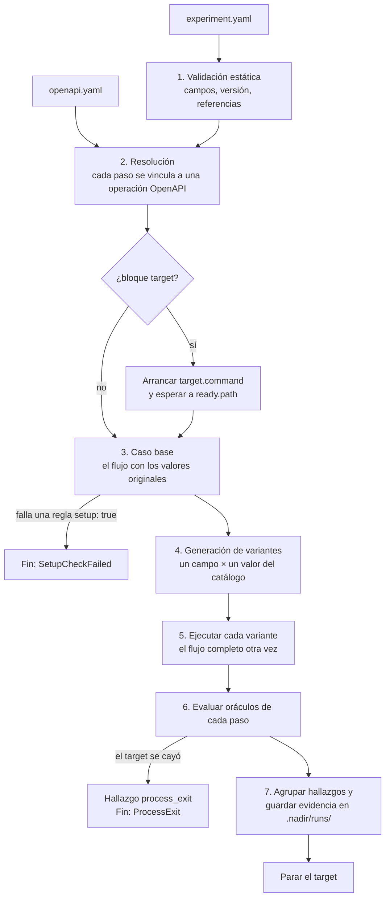

# Nadir

Nadir busca errores en APIs HTTP locales. Ejecuta un **flujo de trabajo** de varias peticiones (por ejemplo: iniciar sesión → obtener una plantilla → crear un registro → verificarlo), luego repite ese flujo cambiando **un solo campo a la vez** con valores problemáticos, y comprueba en cada repetición unas **reglas** (oráculos) que tú defines. Cada regla que falla queda guardada como evidencia JSON que se puede **reproducir** después para confirmar si el error se corrigió.

Tú describes el flujo en un archivo YAML (el *experimento*), y las operaciones HTTP se toman de la especificación OpenAPI de tu servicio.

> **Estado actual:** Nadir prueba valores de catálogos fijos, valores derivados del esquema OpenAPI de cada campo (`mode: schema`) y tus propios valores. Con `strategy: fuzz` añade una fase de **casos aleatorios** reproducibles por semilla. Es fuzzing de caja negra: el fuzzing guiado por cobertura (`target.coverage`, `--corpus`) se reconoce en el YAML, pero `nadir run` lo rechaza. Más detalles en [Limitaciones](doc/limitations.md#limitaciones).

---

## Índice

En esta página:

1. [Cómo funciona](#cómo-funciona)
2. [Inicio rápido (demo)](#inicio-rápido-demo)
3. [Comandos y códigos de salida](#comandos-y-códigos-de-salida)

Documentación de referencia, en [`doc/`](doc/):

| Página | Contenido |
|---|---|
| [Mapa de capacidades](doc/capabilities.md) | Protocolos, mutadores, modos, reglas implícitas, selectores y `replay`, en tablas |
| [Configuración: el archivo de experimento](doc/experiment.md) | Estructura completa, `exploration`, `max_cases`, referencias `${...}`, `target`, `bind`, `auth`, `outputs`, `hidden` |
| [`cases`: qué variar](doc/cases.md) | Mutadores `json` y `http`, corpus de texto, `examples`, nombres de claves y sintaxis JSON |
| [`http_raw` y `malform`](doc/http-raw.md) | Peticiones HTTP mal formadas |
| [`protocol: cli`](doc/cli.md) | Comandos locales, `env_file`, `workdir`, `service`, mutador `envar` y `mode: spec` |
| [`oracles`](doc/oracles.md) | Qué se considera un error y selectores |
| [Pantalla, resultados y reproducción](doc/output.md) | `print`, `debug`, registros, `replay`, `artifacts/crashes/`, diagnósticos |
| [Guía: probar tu propio servicio](doc/guide.md) | Pasos para tu servicio y ejemplos incluidos |
| [Limitaciones](doc/limitations.md) | Lo que Nadir todavía no hace |
| [Arquitectura del código](doc/architecture.md) | Módulos y flujo interno |

---

## Cómo funciona



Paso a paso:

1. **Validación estática.** Se lee el YAML. Cualquier campo desconocido o mal escrito es un error. Se comprueba la versión (`1`), que los `id` de paso no se repitan, que un paso solo haga referencia a pasos *anteriores*, y que no mutes un campo del cuerpo que ya fijaste con `bind`.
2. **Resolución contra OpenAPI.** Cada paso indica `operation_id` u `operation_path`. Nadir resuelve el método, la ruta, los parámetros obligatorios, los esquemas de autenticación y el cuerpo JSON de ejemplo.

   Si el experimento tiene un bloque [`target`](doc/experiment.md#target-que-nadir-arranque-tu-servicio), Nadir arranca ahora tu servicio y espera a que responda. Si no lo tiene, el servicio debe estar ya corriendo.
3. **Caso base (baseline).** Se ejecutan todos los pasos en orden con los valores normales. Para cada petición:
   - el cuerpo parte de `body_example` si el paso lo declara, o del `example` del `requestBody` en el OpenAPI. Luego se aplican los valores de `bind`;
   - se resuelven las referencias `${...}`: variables de entorno, salidas de pasos anteriores (como un token) y un `${case.id}` único por caso;
   - después de recibir la respuesta se extraen los `outputs` y se evalúan los `oracles`.

   Si una regla marcada con `setup: true` no pasa en el caso base, la ejecución se detiene, porque las variantes no tendrían sentido (por ejemplo, si el login falla).
4. **Generación de variantes.** Para cada campo declarado en `cases.mutators`, Nadir genera un caso por cada valor del catálogo. Se omiten los duplicados y los valores iguales al del caso base. Cada variante cambia **exactamente un campo de un paso**.
5. **Ejecución de variantes.** Cada variante vuelve a ejecutar el flujo **completo** desde el principio, con un `${case.id}` nuevo. Los valores dinámicos, como los tokens, se obtienen otra vez en cada caso. Después se ejecutan los `cases.examples`, si los hay. Si Nadir arrancó el servicio y este muere durante un caso, se registra un hallazgo `process_exit` y la ejecución se detiene. Con `strategy: fuzz`, después sigue una [fase de casos aleatorios](doc/experiment.md#exploration-enumeración-o-fuzzing) hasta agotar `duration_s` o `max_execs`.
6. **Evaluación.** Cada oráculo da un veredicto: `pass`, `fail`, `skipped` (no se cumplió su condición `when`) o `inconclusive` (no hubo respuesta utilizable, por ejemplo por un timeout).
7. **Hallazgos y evidencia.** Cada `fail` es un hallazgo. Los hallazgos repetidos se agrupan por paso, regla y categoría. Se escriben `run.json` y un JSON por caso, con un *plan de regresión* que permite reproducir la variante exacta más tarde.

### Medidas de seguridad integradas

- Solo se hacen peticiones a direcciones **loopback**: `127.0.0.0/8` o `[::1]`. El nombre `localhost` se rechaza; usa la IP.
- No se siguen redirecciones (se devuelve el 3xx tal cual) y no se usa ningún proxy.
- Los cuerpos de respuesta se truncan a 256 KiB. Un cuerpo truncado produce `inconclusive` en el oráculo `openapi`.
- Solo se oculta lo que declaras: los valores de las variables listadas en [`hidden`](doc/experiment.md#hidden-qué-se-oculta) y los `outputs` con `secret: true` aparecen como `[hidden]` en pantalla, reportes y evidencia. Lo demás se muestra tal cual.

---

## Inicio rápido (demo)

Requisitos: Linux, Rust estable con Cargo, Python 3.9 o superior y los puertos locales 8080, 8081 y 8091 libres. Ejecuta los comandos desde la raíz del repositorio. No hace falta definir ninguna variable de entorno.

```bash
cargo build
```
```bash
./target/debug/nadir run examples/create-record/experiment.yaml
```

El bloque [`target`](doc/experiment.md#target-que-nadir-arranque-tu-servicio) del experimento hace que Nadir arranque la API de ejemplo ([tests/fixtures/python_api/server.py](tests/fixtures/python_api/server.py)), espere a que responda en `/health`, ejecute [el experimento create-record](examples/create-record/experiment.yaml) y pare la API al terminar. Salida esperada:

```text
Target ready: pid 12844 at http://127.0.0.1:8080/health
Enumeration cases: 7
Findings: 0
Stop reason: EnumerationComplete
Run record: …/examples/create-record/.nadir/runs/<run-id>/run.json
```

`Enumeration cases: 7` cuenta las variantes, sin incluir el caso base: 2 valores de cabecera (`en`, `es`) más 5 valores *edge cases* para `title`.

Ahora activa un error a propósito en el servidor (la plantilla devuelve un título distinto cuando `Accept-Language: es`):

```bash
NADIR_FIXTURE_MODE=title_regression ./target/debug/nadir run examples/create-record/experiment.yaml
```

```text
step get_template, rule template-title-preserved: fail; expected "Invoice Template", observed "Invoice Template (draft)"
case record: …/.nadir/runs/<run-id>/cases/0002.json
replay: nadir replay '…/experiment.yaml' --case '…/cases/0002.json'
Findings: 1
```

El código de salida es `1`. Reproduce ese caso concreto con y sin el error:

```bash
case_file='/ruta/de/la/linea/case-record.json'
NADIR_FIXTURE_MODE=title_regression ./target/debug/nadir replay examples/create-record/experiment.yaml --case "$case_file"   # sale con 1: el error sigue
./target/debug/nadir replay examples/create-record/experiment.yaml --case "$case_file"                                       # sale con 0: corregido
```

[`demo.py`](examples/create-record/demo.py) hace lo mismo con opciones más cortas: `python3 examples/create-record/demo.py [--regression] [--case archivo.json]`.

---

## Comandos y códigos de salida

Compila con `cargo build` y usa `target/debug/nadir`, o sustituye `nadir` por `cargo run --` desde la raíz.

| Comando | Qué hace |
|---|---|
| `nadir validate experiment.yaml` | Valida el YAML y lo resuelve contra el OpenAPI. No hace peticiones de red. |
| `nadir run experiment.yaml` | Ejecuta el caso base y todas las variantes. Usa un servicio que ya esté corriendo o, si hay bloque `target`, lo arranca y lo para Nadir. |
| `nadir replay experiment.yaml --case case.json` | Repite un caso guardado contra el servicio actual, con un `case.id` nuevo. Con bloque `target`, arranca un servicio nuevo para la repetición. |

Si tu experimento usa una variable de entorno sin valor por defecto (`${env.NOMBRE}`), defínela antes de ejecutar (`export NOMBRE=...`). Si falta, la preparación falla con código `2` y el mensaje indica cuál es. Con `${env.NOMBRE:-valor}`, la variable es opcional.

| Código | Significado |
|---|---|
| `0` | Terminó sin reglas fallidas, o la validación fue correcta. |
| `1` | Hay al menos un hallazgo: una regla falló o el servicio arrancado por Nadir se cayó. |
| `2` | Error de configuración o de infraestructura (por ejemplo, el `target` no arrancó), ejecución incompleta (timeout, conexión cortada, caso base incompleto) o fallo de una regla `setup`. |

Esto permite usar Nadir directamente en CI: `nadir run ... || exit 1`.
